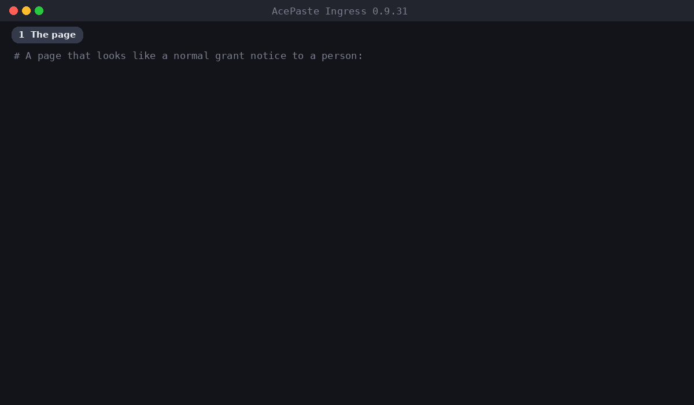

# @acepaste/ingress

**Stops your AI agent from obeying instructions that web pages hide from you.**



**The problem:** a web page can hide text that a person never sees, and an AI agent reads all of it: white-on-white text, invisible Unicode, off-screen notes, or a different page served only to bots. The agent can follow those instructions, and afterward nobody can show what it read. Ingress sits in front of your agent's web fetch and refuses anything the model would receive that you would not see.

- **Refuses hidden instructions:** invisible Unicode, CSS-hidden or background-coloured text, and payloads in attributes, comments, SVG or `srcdoc`.
- **Catches cloaking:** fetches twice, and can render in a throwaway browser, to catch pages that show bots something different.
- **Signs a receipt for every verdict:** hash-chained and signed with ECDSA P-256, so you can prove later what your agent read.
- **Quarantines sources:** block a host and see everything it already delivered.
- **Asks a person before risky actions:** once outside content is read, side-effecting tool calls need human approval.
- **Checks your MCP servers:** `ingress mcpscan` finds poisoned tool descriptions, tools that give orders about other tools, look-alike tool names, and tools that changed after you pinned them.
- **Checks your own APIs:** `ingress apiscan` looks for exposed files, open CORS, missing auth, leaked keys and responses an agent would obey, using only safe read requests.
- **Gates repos for coding agents:** `ingress reposcan` and a GitHub Action flag Trojan Source Unicode, instructions hidden in markdown, poisoned AGENTS.md files and install scripts that download and run code.
- **Runs on your machine:** MCP server, CLI and library, or HTTP service. No telemetry ([PRIVACY.md](https://github.com/sugarcypher/acepasteINGRESS/blob/main/PRIVACY.md)).


---

The AcePaste Ingress engine: a security gate between internet content and AI ingestion. Anything a model would receive that a human looking at the same source would not see is suspect by default.

```ts
import { IngressEngine } from "@acepaste/ingress";
const ingress = new IngressEngine({ signingKey: process.env.INGRESS_SIGNING_KEY });
const r = await ingress.fetch("https://example.com/doc");   // or ingress.scan(text)
model.push(r.envelope);   // clean text in a provenance envelope, or a refusal with the reason
```

Verdicts: `clean` (delivered with a signed receipt), `suspect` (refused, human-overridable), `hostile` (refused, not overridable). Passes: acquire, policy, visibility, character (the production AcePaste invisible alphabet), script and supply-chain (underlight lineage), sandbox (optional headless Chromium), meaning, plugins.

CLI: `npx @acepaste/ingress https://example.com` or `ingress --text < page.html`.

## MCP scan

`ingress mcpscan [--config file] [--connect] [--url URL [--header "Name: value"]] [--json]` checks the MCP servers
in your AI apps' config files (Claude Desktop, Claude Code, Cursor, Windsurf, VS Code, Gemini CLI, `./.mcp.json`).
Without `--connect` it reads only the configs: download-and-run launch commands, unpinned `npx`/`uvx` packages,
credentials written into the file (names only) and plain-http servers. With `--connect` it starts each server
(this runs the server's code), lists its tools, prompts and resources, and shuts it down; no tool is ever called.
Every description is scanned for hidden instructions, invisible characters, orders aimed at the model, orders about
another server's tools, and look-alike tool names. Each server's tool list is pinned by fingerprint in the Ingress
state directory; later scans show tools added, removed or changed, with the old and new text. `ingress mcpscan pin
--connect` accepts the current tools. Exit code 1 when any finding is high. In code: `mcpscan(options)`.

## API scan

`ingress apiscan <base-url> [--spec openapi.json|url] [--auth-header "Name: value"] [--burst] [--json] [--max-requests N]`
checks an HTTP API you own, or are authorized to test, for common mistakes: plain HTTP, missing security headers,
open CORS, routes that answer without auth (from a JSON OpenAPI spec), exposed files such as `.env` and `.git`,
stack traces, version headers, leaked credentials, missing rate limits (only with `--burst`), and responses an AI
agent would read as instructions. It sends only GET, HEAD and OPTIONS requests, no bodies and no attack payloads,
about 60 at most, to the URL you give. Exit code 1 when any finding is high. In code: `apiscan(url, options)`.
YAML specs are not read; convert them to JSON.

## See what your agent sees

`ingress show <url|file> [--out report.html] [--open]` writes one static HTML page with what a person sees beside
what your AI agent receives. Hidden text is highlighted in place by kind (CSS, colour match, invisible Unicode,
comments and attributes, text served only to AI fetchers), with the verdict, the findings linked to their
highlights, the bots-versus-browsers comparison and the receipt digest. No scripts or remote content; everything
from the page is escaped. `ingress show --term <url|file>` prints the same in the terminal with hidden spans in red
brackets. In code: `show()`, `renderShowHtml()`, `renderShowTerm()`.

## Repo scan

`ingress reposcan [dir] [--diff <git-ref>] [--json] [--sarif <file>|-]` checks a repository before a coding
agent reads it: bidirectional and invisible Unicode (Trojan Source, tag characters, zero-width), instructions
hidden in markdown comments, `<details>`, hidden styles, link titles and alt text, agent instruction files
(AGENTS.md, CLAUDE.md, .cursorrules and the rest) that tell the agent to run downloads, read secrets, turn off
safety or skip review, install scripts that download and run code, and risky MCP configs. Local only, no network.
`--diff` scans only files changed since a git ref; `--sarif` writes SARIF 2.1.0 for GitHub code scanning. Exit
code 1 when any finding is high. In code: `reposcan(dir, options)` and `toSarif(report)`. GitHub Action and
pre-commit hook: https://github.com/sugarcypher/acepasteINGRESS/blob/main/docs/REPOSCAN.md

Full documentation: https://github.com/sugarcypher/acepasteINGRESS
