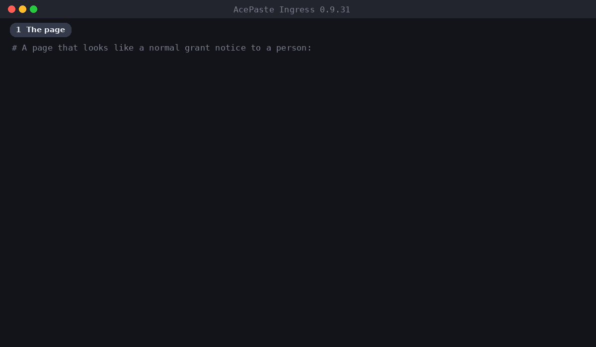

# @acepaste/ingress-http

**Stops your AI agent from obeying instructions that web pages hide from you.**



**The problem:** a web page can hide text that a person never sees, and an AI agent reads all of it: white-on-white text, invisible Unicode, off-screen notes, or a different page served only to bots. The agent can follow those instructions, and afterward nobody can show what it read. Ingress sits in front of your agent's web fetch and refuses anything the model would receive that you would not see.

- **Refuses hidden instructions:** invisible Unicode, CSS-hidden or background-coloured text, and payloads in attributes, comments, SVG or `srcdoc`.
- **Catches cloaking:** fetches twice, and can render in a throwaway browser, to catch pages that show bots something different.
- **Signs a receipt for every verdict:** hash-chained and signed with ECDSA P-256, so you can prove later what your agent read.
- **Quarantines sources:** block a host and see everything it already delivered.
- **Asks a person before risky actions:** once outside content is read, side-effecting tool calls need human approval.
- **Runs on your machine:** MCP server, CLI and library, or HTTP service. No telemetry ([PRIVACY.md](https://github.com/sugarcypher/acepasteINGRESS/blob/main/PRIVACY.md)).

Full documentation: https://github.com/sugarcypher/acepasteINGRESS

---

AcePaste Ingress as a metered HTTP service with a public attack feed and a per-key audit plane.

```sh
PORT=8787 INGRESS_KEYS="key1:acme" INGRESS_SIGNING_KEY=… npx @acepaste/ingress-http
```

`POST /v1/scan`, `POST /v1/fetch`, `POST /v1/verify` (Bearer key; refusals return 422). `GET /v1/feed` and `/` (public attack feed: attacking hosts and payload excerpts, never customer content). `GET /v1/receipts`, `/v1/receipts/export`, `/v1/receipts/stats`, `/console` (the caller's own signed receipts).

Full documentation and deploy notes: https://github.com/sugarcypher/acepasteINGRESS
