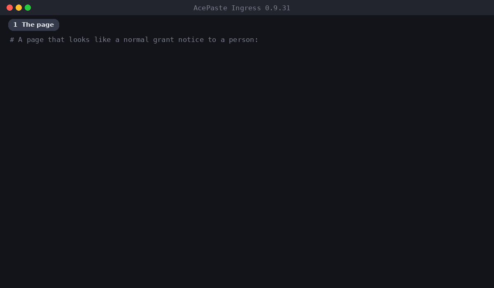

# @acepaste/ingress-mcp

**Stops your AI agent from obeying hidden instructions in web pages, files, repos and MCP tools, and catches data leaks.**



**The problem:** an AI agent reads everything, including what a person never sees: white-on-white text on a web page, invisible Unicode in a repo, a hidden layer in a PDF, a poisoned tool description in an MCP server. It can follow those instructions, slip your data out inside a link or an image, or install a package an AI made up, and afterward nobody can show what it read. Ingress checks what goes into your agent and what comes out, and refuses anything the model would receive that you would not see.

- **Refuses hidden instructions in web pages:** invisible Unicode, CSS-hidden or same-colour text, payloads in attributes, comments, SVG or `srcdoc`, and pages that show bots something different. `ingress https://example.com`
- **Shows you what your agent sees:** `ingress show` writes one HTML page with what a person sees beside what the agent receives, hidden text highlighted. `ingress show https://example.com --open`
- **Checks files and knowledge bases:** `ingress filescan` finds hidden text in PDFs, Word, Excel, PowerPoint and images; `ingress corpusscan` checks a whole RAG folder and moves hostile files aside. `ingress corpusscan ./docs --quarantine ./held`
- **Checks your MCP servers:** `ingress mcpscan` finds poisoned tool descriptions, look-alike tool names and tools that changed since you pinned them. `ingress mcpscan --connect`
- **Gates repos for coding agents:** `ingress reposcan` and a GitHub Action flag Trojan Source Unicode, instructions hidden in markdown, poisoned AGENTS.md files and risky install scripts. `ingress reposcan --diff origin/main`
- **Catches data leaving in links and images:** `ingress outcheck` reads a model's reply for data hidden in image URLs, links and subdomains before it is rendered; the action broker does the same for tool calls. `ingress outcheck --safe < reply.md`
- **Checks packages before install:** `ingress pkgcheck` catches made-up package names, lookalikes of popular ones and brand-new packages with install scripts. `ingress pkgcheck npm left-pad`
- **Checks your own APIs:** `ingress apiscan` looks for exposed files, open CORS, missing auth, leaked keys and responses an agent would obey, with safe read-only requests. `ingress apiscan https://api.example.com`
- **Signs a receipt for every verdict, and asks a person before risky actions:** hash-chained ECDSA P-256 receipts prove later what your agent read; once outside content is read, side-effecting tool calls need human approval.
- **Quarantines sources:** block a host and see everything it already delivered.
- **Runs on your machine:** MCP server, CLI and library, or HTTP service. No telemetry ([PRIVACY.md](https://github.com/sugarcypher/acepasteINGRESS/blob/main/PRIVACY.md)).

Every command runs as `npx @acepaste/ingress <command>`, or as `ingress <command>` after `npm install -g @acepaste/ingress`.

Full documentation: https://github.com/sugarcypher/acepasteINGRESS

---

AcePaste Ingress as a Model Context Protocol server. Put it in front of an agent's web access: hostile pages are refused and never reach the model; every verdict leaves a signed receipt.

```json
{
  "mcpServers": {
    "acepaste-ingress": {
      "command": "npx",
      "args": ["-y", "@acepaste/ingress-mcp"],
      "env": { "INGRESS_SANDBOX": "off" }
    }
  }
}
```

Tools: `ingress_fetch(url, override?)`, `ingress_scan(content, source?, contentType?, override?)`, `ingress_status()`, `ingress_confirm()`, `ingress_verify_receipt(receipt)`.

Environment: `INGRESS_SIGNING_KEY`, `INGRESS_HOSTILE`, `INGRESS_SUSPECT`, `INGRESS_CLOAKING=0`, `INGRESS_SANDBOX=off|escalate|always`, `INGRESS_POLICY=path`, `INGRESS_LOG=path`.

Full documentation: https://github.com/sugarcypher/acepasteINGRESS
